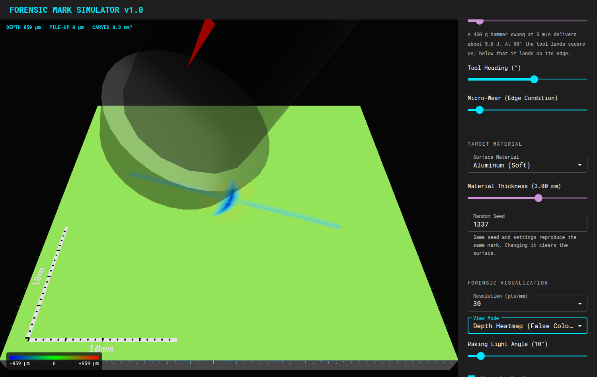

# Forensic Mark Simulator

A small 3D lab for generating forensic-style tool marks.

Pick a tool, pick a material, tune the force/angle/speed, then run the simulation and inspect the mark with forensic visualization modes.



`example1.gif` in the repository shows an earlier version of the interface.

## What It Does

- Simulates scratches and gouges (a tool dragged 40 mm) and impacts (a tool driven in by a single blow) on a 60 mm surface.
- Supports screwdriver, knife, crowbar, hammer face, hammer claw, and spoon profiles.
- Supports aluminum, brass, steel, wood, and gold target materials.
- Models contact patches, plastic deformation, pile-up, springback, chatter, wear, and striation detail.
- Models material thickness, accumulated fracture damage, ductile and brittle tearing, lifted tear edges, detached cells, and deposited debris.
- Renders detached material as real holes in the surface mesh, with plate side walls and fracture-wall thickness instead of a color or depth trick.
- Renders the result in a Three.js viewport with orbit controls.
- Includes depth heatmap, normal map, raking light, scale bars, and optional 3D tool display.
- Scales the depth heatmap to the relief that is actually present and shows the range in a legend.
- Reports each pass: cut depth, pile-up height, carved volume, and torn-out cells, or that the contact left no visible mark.
- Leaves the same mark whichever direction the tool is dragged or turned.
- Uses deterministic seeds so a run can be repeated. The seed is set in the side panel.
- Runs without network access: lighting and labels are generated locally.

## Quick Start

```bash
npm install
npm run dev
```

Then open the local Vite URL shown in the terminal.

## Scripts

```bash
npm run dev      # start the app
npm run build    # typecheck and build
npm run lint     # run ESLint
npm test         # compile the tests into dist-tests/ (not tracked) and run them
npm run preview  # preview the production build
```

## How To Use

1. Choose a tool profile, an action (drag or strike), and a target material. Picking the hammer face selects strike; every other tool starts on drag.
2. For a drag, adjust hardness, force, angle, direction, speed, chatter, wear, material thickness, and time step. For a strike, set the blow energy in joules, the angle (90° lands square on, less lands on the tool's edge), and the heading.
3. Choose a render resolution and view mode.
4. Click `EXECUTE SIMULATION`. Settings are locked until the pass finishes.
5. Read the result line above the plate, then inspect the mark with raking light, heatmap, normal map, and scale bars.

A drag is 40 mm long and centred on the plate, so it stays on the surface for any drag direction. A blow lands in the middle of the plate. Running again without `CLEAR SURFACE` adds another pass over the existing mark.

Marks are drawn at true scale. A hand-force scratch in metal is tens of microns deep, so use a low raking light angle or the depth heatmap to see it. A mark shallower than 10 µm is reported as not visible, because the plate's own finish is rougher than that: a hammer face dragged flat over metal, for example, only burnishes it.

## Contact Model

The tool is a height profile on a grid fixed to the tool, with its outer samples exactly on the tool's edges. The drag direction is applied only when the tool is pressed into the surface: the tool height over each surface cell is interpolated at the cell's exact position under the tool, and a cell that the trailing edge passed over between two stamps is cut to the edge height. The mark therefore does not depend on how the path or the tool lines up with the surface grid. The tool path is the line its contact point follows.

**Drag.** Penetration comes from the load and the target's indentation hardness: the tool sinks until its load-bearing area times the hardness equals the normal force. A sliding tool is carried by its forward-facing faces only, because behind its lowest point it has lost contact. Chatter modulates the load, so its depth swing scales with the force. The path wanders sideways with hand tremor, which is a function of time and does not depend on the time step.

**Strike.** A blow spends its energy as plastic work against the hardness, so the impression displaces a volume of energy divided by hardness (Tabor's dynamic hardness). Only the velocity component normal to the surface counts. A square blow prints the face; a tilted one digs its rim in and leaves a crescent.

**Springback.** Each surface cell springs back by its elastic share and keeps the plastic remainder. The elastic deflection scales with the size of the loaded patch, taken as the diameter of a circle with the same load-bearing area.

**Where the material goes.** In a drag, displaced material is pushed ahead of the tool into a prow that can stand no taller than the cut is deep. What the prow cannot hold escapes sideways into ridges, and only material within four cut depths of an edge gets there; the rest leaves as chips. A share of the fresh cut that grows with friction and with how sticky the material is gets smeared back behind the tool. Around an impression, material within reach of the rim is squeezed out into a low bank that cannot rise into the tool. Material that was moved is tracked separately from the plate, so pushing loose pile-up along does not count as cutting and does not damage the plate underneath.

### What is checked, and what is not

These relations are tested against closed-form results:

- A ball dragged under a known load leaves a scratch whose width gives back the material's hardness through the ASTM G171 scratch-hardness formula, within 25%.
- A ball driven in by a blow displaces the spherical cap that its energy and the hardness predict, within 5%.
- Carved volume and groove volume are the same in every drag direction within a few percent.
- Pile-up never holds more material than was cut out of the plate.

Hardness, elastic modulus, yield strength and fracture energy are handbook-range values. Everything that shapes the mark beyond that is a rule of thumb that has not been compared with measured tool marks: the share of material that goes to the prow, the ridges, the smear and the chips; ridge and rim widths; tear roughness; chatter and tremor amplitudes; and the whole fracture model. Output from this simulator is an illustration, not forensic evidence.

## Fracture Model

The simulator tracks material damage separately from surface height. Each surface cell stores accumulated damage, detachment state, lifted fracture-edge height, and debris height. The damage model samples local height gradients, curvature, damage gradients, and damage Laplacian with finite differences so crack growth and edge lift respond to local field concentrations rather than only single-cell depth.

When local contact work, shear loading, plastic strain, and field concentration exceed the material's fracture thresholds, the cell detaches and adjacent triangles are removed from the mesh. A cut as deep as the plate is thick also goes through it.

A ductile plate tears only where the cut has weakened it: fracture reaches its full rate once half the thickness is gone, so a shallow groove in a thick plate stays a groove. Brittle materials crack from the surface and need proportionally less. The work that feeds a crack is collected over a fixed width, so fracture does not depend on the grid resolution.

This produces visible holes, ragged raised edges, and debris deposits. Thicker targets require more energy to perforate and are rendered as visibly thicker plates, including side walls around torn-through openings. Brittle materials such as wood fail earlier and propagate cracks more readily, and ductile metals require more plastic strain before detaching.

## Project Shape

```text
src/
  components/
    Controls.tsx       # side panel controls
    ForensicLab.tsx    # Three.js lab viewport
    Tools3D.tsx        # tool models
  utils/
    SimulationEngine.ts # core simulation loop, fracture state, mesh index helpers
    elasticPlastic.ts   # material response helpers
    random.ts           # seeded randomness
    striations.ts       # edge micro-geometry
tests/
  simulationEngine.test.ts # engine behaviour: depth, direction, strikes, pile-up, fracture, reference checks
  elasticPlastic.test.ts
  striations.test.ts
nairn-mpm/                 # separate prototype for running scenarios through an external NairnMPM solver
```

## Reality Check

This is an interactive simulator, not validated forensic evidence software.

The contact and fracture models are physically motivated and deterministic, but they are not a full FEM or MPM solver, and their constants are plausible values that have not been calibrated against measured marks. They use finite-difference field sampling and a local continuum-damage approximation tuned for interactive browser use. See [BACKLOG.md](BACKLOG.md) for the calibration, friction, material, and rendering work that remains.
